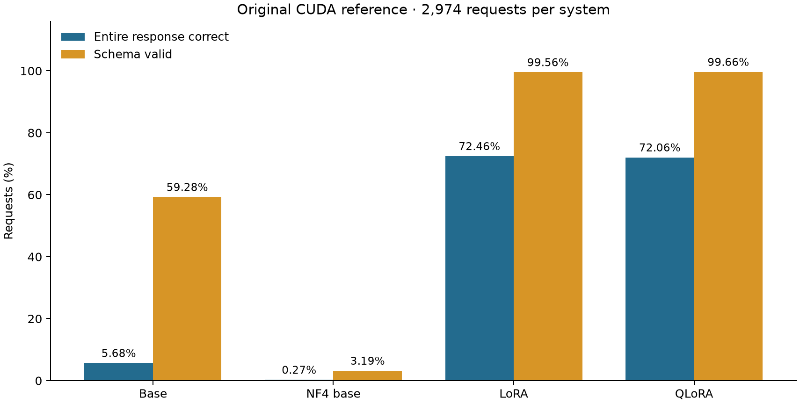

# Structured Request Reliability

[GitHub repository](https://github.com/gour6380/Structured-Request-Reliability)

Evaluate and serve frozen Qwen2.5-1.5B-Instruct LoRA/QLoRA adapters on Apple
Silicon. This standalone, inference-only project provides strict request-to-JSON
scoring, artifact checks, regression gates, an executable notebook and a bounded
local API.

**Recorded result:** QLoRA reproduces all eight fixed reference continuations and
generated token sequences on MPS, with zero quality regressions. Four of those
eight answers are correct. LoRA stopped during loading in two attempts at the
memory guard. Full-test MPS parity and latency benchmarking remain pending.

The latest saved notebook ran in **replay mode**: it verified files and rescored
saved responses, then displayed those existing results. It produced no new model
predictions. See the [technical report](reports/technical-report.md),
[aggregate evidence and provenance](reports/public/results.json), and
[executable notebook](notebooks/public/structured_request_reliability.ipynb).

## Results at a glance

The measurements and test results below are the recorded **30 September 2026**
evidence. Repository preparation does not constitute a new model run.

| Evidence | Result |
|---|---|
| Frozen bundle | 73 files, 4.15 GiB; SHA-256 verification passed |
| Saved CUDA comparison, 2,974 requests/system | LoRA 72.46%, QLoRA 72.06% entire-response accuracy |
| QLoRA on MPS, eight fixed requests | 8/8 text/token matches; 4/8 correct; 8/8 schema-valid |
| LoRA on MPS | Two loading stops; no completed predictions |
| Real-model API check | Repeated response, invalid input and shutdown passed in process |
| Recorded software verification | 127 tests and 38 subtests passed |
| Latest saved notebook | 19 code cells executed; replay only, no recorded errors |



The chart shows rescored **source CUDA** outputs, not a full MPS evaluation. A
schema-valid answer can still have the wrong intent or slots. The test set is
reused regression evidence, and an eight-case pass does not establish general
hardware equivalence or performance on new requests.

## Set up the project

Clone the repository into a new directory, or skip this step if you already have
the project locally:

```sh
git clone https://github.com/gour6380/Structured-Request-Reliability.git structured-request-reliability
cd structured-request-reliability
```

SSH clone URL: `git@github.com:gour6380/Structured-Request-Reliability.git`.

Use native arm64 Python 3.13 on macOS. From the project root, create the isolated
environment from the lock file:

```sh
uv sync --locked --extra dev --extra notebook --link-mode copy
.venv/bin/python -m ipykernel install --sys-prefix \
  --name structured-request-reliability \
  --display-name "Structured Request Reliability (Python 3.13)"
.venv/bin/python -m pytest -q
```

`uv.lock` pins dependencies; `requirements.txt` is the hashed pip export. The
software tests use synthetic inputs and do not require model weights. Native
runtime validation reported here is macOS/MPS only.

**Model/data prerequisite:** the public source checkout excludes `data/frozen/`.
Restore the complete private 4.15 GiB bundle to that location before running
notebook replay, verification or live inference. It contains both frozen
backbones, adapters, tokenizer, prompt, ontology, test/validation examples,
reference outputs, provenance and `manifest.json`. It must be an independent
copy, with no symlinks or hard links. A plain clone alone cannot reproduce the
reported model results; downloading a fresh base model cannot replace the trained
adapters or the recorded reference outputs.

```sh
.venv/bin/request-reliability verify
```

For an authorized holder of the compatible source training run, the one-time
`scripts/prepare_handoff.py --source /absolute/path/to/source-project` importer
creates the bundle in a fresh destination and refuses to overwrite one. Ordinary
inference never imports the source project. Preserve applicable model and dataset
license notices with the separately retained artifacts.

## Run the notebook

```sh
.venv/bin/python -m jupyter lab notebooks/public/structured_request_reliability.ipynb
```

Select **Structured Request Reliability (Python 3.13)**. In the first setup
output, confirm that `Kernel Python` belongs to this project's `.venv`. The latest
saved working run used the adaptation project's environment; that is recorded as
an environment limitation, even though it completed replay successfully.

The notebook guides setup, hardware checks, bundle verification, source-score
recomputation, charts, regression, a single prediction, timing, an asynchronous
API check and session reporting. Automatic root discovery works from either
notebook directory; `PROJECT_ROOT_OVERRIDE` handles other starting locations.

| Setting | Effect |
|---|---|
| `MODE="replay"` | Default: read matching saved evidence, never start missing inference. |
| `MODE="live"`, `PRESET="smoke8"` | Fresh eight-case QLoRA comparison and one selected prediction. |
| `PRESET="full"` | Explicitly request all 2,974 reused test cases per enabled live comparison. |
| `RUN_LORA`, `RUN_BASELINES` | Optional live comparisons; disabled by default. |
| `RUN_BENCHMARKS`, `RUN_API_CHECK` | Optional timing/API execution; disabled by default. |
| `WRITE_SESSION_REPORT` | Save a new session summary and provenance. |

After changing settings, rerun the settings cell or restart and Run All. Live
stages load and release models sequentially, with fresh report paths for reruns.
The public notebook is output-free. The owner's executed working notebook remains
local at `notebooks/structured_request_reliability.ipynb`; both use the shared
package. Raw local run reports are also excluded from Git: on a clone with only
the frozen bundle restored, absent local comparisons remain **missing** in replay.
The published aggregate evidence is for inspection, not a fabricated replay cache.

## CLI and local service

```sh
# Recompute scores from saved responses; no model generation.
.venv/bin/request-reliability audit

# Fresh bounded QLoRA regression.
.venv/bin/request-reliability compare --systems qlora --count 8 --device mps

# One request.
.venv/bin/request-reliability predict --device mps "wake me up at five am this week"

# Single-worker loopback service; start after notebook inference finishes.
.venv/bin/request-reliability serve --system qlora --device mps --port 8000
```

`GET /health` exposes readiness; `POST /predict` accepts an `utterance` string.
Invalid requests return 422, a busy model 503, a deadline overrun 504, and invalid
model output 502. The CLI returns 2 for schema-invalid output and 1 for setup or
inference errors. Schema validity alone does not establish task correctness.
Timeout/cancellation retains model ownership until native work exits; shutdown
waits before release. Run one server worker; the service is a local research
interface, with no external hosting or load-test claim.

## Memory and measurement

Automatic device selection prefers MPS, then CUDA, then CPU. Explicit CPU uses
FP32 and is a separate execution condition. Failed MPS operations do not silently
fall back to CPU. Dense loading requires at least 6 GiB available memory; NF4
requires 3 GiB. A 128 MiB increase in machine-wide swap stops the run. These
admission bounds do not guarantee fit. Keep LoRA disabled until memory conditions
improve; the two recorded loading stops remain part of the result.

The implemented validation-only timing command is:

```sh
.venv/bin/request-reliability benchmark --system qlora --device mps \
  --requests 8 --repetitions 3
```

It separates loading, first request, two excluded warmups and synchronized measured
requests. No p50/p95, throughput or peak-memory result is claimed yet. Retained
memory observations are point samples, not peaks.

## Repository contents and GitHub preparation

```text
src/request_reliability/  Shared integrity, scoring, inference, regression, API and workflow
notebooks/public/        Output-free executable notebook
configs/                 Fixed regression acceptance rules
tests/                   Synthetic correctness and lifecycle checks
scripts/                 Verified handoff, local checks and public-artifact export
reports/technical-report.md
reports/public/          Curated aggregate evidence and chart
pyproject.toml / uv.lock / requirements.txt
```

The project `.gitignore` excludes environments, caches, model weights, datasets,
raw reports/predictions, local verification receipts, credentials, and working
notebooks. Source, tests, configuration, dependency locks, this README and the
technical report remain eligible for Git. Generated public artifacts use an
explicit allowlist:

- `notebooks/public/structured_request_reliability.ipynb`
- `reports/public/results.json`
- `reports/public/reference-scores.png`

Other files added to those public directories remain ignored until deliberately
reviewed and allowed. Ignoring a file does not remove it from an existing Git
index or history. Before a first submission, verify that `git rev-parse
--show-toplevel` identifies this standalone project directory, and inspect
`git status --short --untracked-files=all` from that root.

When local evidence changes, regenerate the public artifacts from this project's
environment, then review the changes:

```sh
.venv/bin/python scripts/export_public_artifacts.py
```

The exporter preserves the working notebook and raw reports, clears outputs from
the public copy, and writes selected aggregates with source-file hashes. It needs
the local evidence files; a public checkout alone does not contain them. Keep
these local artifacts in a separate backup when sharing the source repository.

The reused scorer's copyright and permission notice is retained in
[source attribution](THIRD_PARTY_NOTICES.md).
