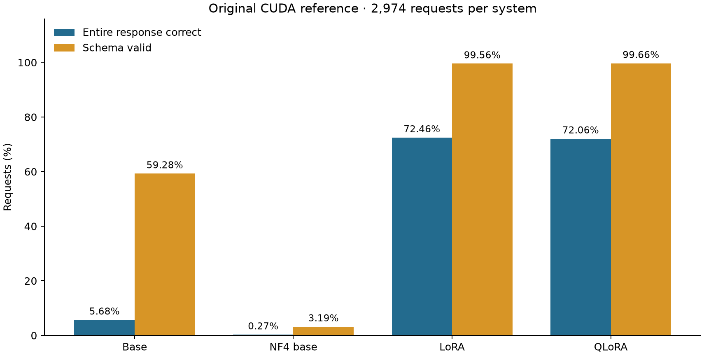

# Frozen adapters on Apple Silicon: regression evidence and serving boundaries

**Evidence reviewed: 1 November 2026.** This report combines the saved CUDA
quality comparison, an eight-request MPS regression check, local serving checks,
and a new bounded QLoRA validation benchmark. The latest saved notebook remains a
historical **replay-mode** execution. The new benchmark ran separately through the
CLI in this project's restored Python 3.13.11 environment.

The strongest result is narrow: an independently copied QLoRA adapter reproduced
all eight fixed CUDA reference continuations and generated token sequences on
MPS. Four of those eight answers were correct. In the new timing run, eight
validation inputs repeated three times produced 24/24 schema-valid responses,
with warm median latency **3.2676 seconds** and p95 **5.4403 seconds**. The timing
run did not score semantic accuracy. LoRA loading stopped twice at the memory
guard, so there is no native LoRA quality or performance result.

[Machine-readable evidence](public/results.json) contains selected aggregate
measurements and hashes of the local source artifacts. The raw runs and executed
working notebook remain local; the [public notebook](../notebooks/public/structured_request_reliability.ipynb)
is an output-free executable copy.

## 1. Question and fixed protocol

Can the final adapters preserve their recorded request-to-JSON behavior when
loaded from an independent local bundle, while making failures explicit?

The primary gate permits **zero whole-record regressions and zero schema-validity
regressions** on the first eight requests in original test-file order. Selection
is independent of outcomes. Exact continuation text and generated token IDs are
measured separately; they are stronger observations than the required quality
gate. Missing requests cannot pass. No prompt tuning, checkpoint substitution,
retraining or output repair occurs in this project.

| Component | Recorded configuration |
|---|---|
| Base model | Qwen2.5-1.5B-Instruct |
| Model revision | `989aa7980e4cf806f80c7fef2b1adb7bc71aa306` |
| Data | MASSIVE 1.1, en-US; 2,974 reused test requests |
| Adapters | Final epoch-five LoRA and QLoRA; rank 16, alpha 32, dropout 0.05 |
| Target modules | `q_proj`, `k_proj`, `v_proj`, `o_proj`, `gate_proj`, `up_proj`, `down_proj` |
| Inherited training budget | 3,600 updates and 1,172,405 target tokens per adapted arm; seed 2027 |
| QLoRA backbone | Saved NF4 weights, double quantization, BF16 compute |
| Generation | Greedy (`do_sample=False`), one beam, at most 256 new tokens, KV cache enabled |
| Context | At most 2,048 tokens; fixed prompt, tokenizer and ontology |
| Source / local batching | CUDA batches of 32 / MPS batch one |
| Local runtime | Python 3.13.11; torch 2.14.0, transformers 5.17.0, PEFT 0.21.0, bitsandbytes 0.50.2 |

The saved generation configuration also retains inherited settings such as a
1.1 repetition penalty. Terminal EOS/PAD tokens alone are stripped. The full
frozen decoding configuration is recorded in the public evidence. This project
consumes the source training result; it does not re-estimate training memory or
training speed.

## 2. Artifact and scoring integrity

The independent bundle contains **73 files / 4,451,390,755 bytes (4.15 GiB)**:
matching dense/NF4 backbones, adapters, tokenizer, prompt, ontology, evaluation
inputs, source predictions and provenance. SHA-256 verification covers every
registered file. The original handoff also checked independent file copies and
inodes. Four source metadata documents lacked inherited self-checksums; their
hashes attest to the handoff observation, not an earlier independent authority.

The scorer parses the complete response. It rejects duplicate keys, Markdown
fences, nonstandard JSON constants, extra fields, wrong types and unknown labels.
Whole-record correctness requires the correct intent and the exact multiset of
slot type/value pairs, preserving repeated slots and case-sensitive values.
Schema validity checks structure and ontology membership; it does not establish
semantic correctness. Invalid outputs stay in the evaluation denominator.

All four saved 2,974-response sets were rescored and matched their recorded
row-level score fields and aggregate metrics. This establishes consistency with
the source scoring protocol, not an independent untouched evaluation dataset.

The source retained the official splits without removing duplicate utterances.
Both its exact and normalized audits record **88 duplicate groups, 37 cross-split
groups and nine groups with conflicting annotations**. There are **26 test
utterances** whose normalized form also occurs in training or validation. The
2,948-request novel-input subset below excludes those test rows; this does not
remove semantic near-duplicates or establish absence of pretraining contamination.

## 3. Recomputed source results

These measurements come from saved **CUDA** responses. They are not full-test MPS
measurements. Accuracy and validity columns are percentages; F1 columns use 0–1.

| System | Entire response correct | Schema valid | Intent correct | Intent macro F1 | Slot F1 |
|---|---:|---:|---:|---:|---:|
| Dense base | 5.68% (169/2,974) | 59.28% | 32.85% | 0.3480 | 0.1465 |
| NF4 base | 0.27% (8/2,974) | 3.19% | 1.82% | 0.0272 | 0.0154 |
| LoRA | 72.46% (2,155/2,974) | 99.56% | 89.95% | 0.8714 | 0.8130 |
| QLoRA | 72.06% (2,143/2,974) | 99.66% | 89.27% | 0.8694 | 0.8131 |

**Observation:** adaptation is associated with substantially higher correctness
and schema validity in this fixed source experiment. LoRA has 12 more fully
correct responses than QLoRA, a difference of about 0.40 percentage points.

**Interpretation:** structured-output learning transferred into the frozen
artifacts, but near-perfect schema validity still leaves substantial semantic
errors. The single paired seed and inspected test set do not establish general
superiority of either adaptation method or statistical equivalence.

The NF4 base result is particularly poor: 2,752 responses are invalid JSON.
That is an observed property of this exact frozen baseline, prompt and runtime.
It does not isolate a universal causal effect of four-bit quantization.

| Recorded semantic failure category | LoRA | QLoRA |
|---|---:|---:|
| Wrong intent | 298 | 319 |
| Missing slots | 337 | 334 |
| Extra slots | 359 | 370 |
| Wrong slot values | 143 | 145 |

Failure categories can overlap within one response and must not be summed into
an overall error count. For example, a valid JSON record may contain both a wrong
intent and missing slots.

### What the comparisons isolate

All four saved prediction files align on IDs, utterances, targets and prompt-token
counts for every one of the 2,974 requests. They use the same base revision,
tokenizer, system prompt, ontology, scorer, CUDA batch size 32 and generation
implementation. The two training arms share seed 2027, training-ID hash, initial
adapter hash, adapter targets/rank, optimizer settings, 57,570 example exposures,
3,600 updates and 1,172,405 target tokens. Both use the final checkpoint after
five epochs. Shared non-projection parameters retain the same FP32 policy.

| Contrast | Entire-response accuracy change | Supported interpretation |
|---|---:|---|
| Dense base → LoRA | +66.78 percentage points | Adaptation improves this fixed prompt/decoder baseline. |
| NF4 base → QLoRA | +71.79 percentage points | Adaptation improves this saved NF4 baseline under the fixed protocol. |
| LoRA → QLoRA | −0.40 percentage points | A small descriptive difference from one paired training seed. |
| Dense base → NF4 base | −5.41 percentage points | This particular frozen quantized baseline performs poorly. |

The paired LoRA/QLoRA outcomes are **2,028 both correct, 127 LoRA-only correct,
115 QLoRA-only correct and 704 neither correct**. Thus the 12-answer net gap hides
242 disagreements in correctness. These descriptive counts are not a
multi-seed superiority or equivalence test.

| Factor | Controlled here | Remaining attribution limit |
|---|---|---|
| Prompt | Same frozen system prompt and chat template across the four source arms. | No tuned prompt-only or few-shot baseline; adaptation is not shown necessary or best among all prompting strategies. |
| Decoding | Same greedy decoder, one beam, 256-token cap, KV cache, terminal-token policy and active repetition penalty 1.1. | No constrained-decoder or output-repair ablation. Sampling settings are inactive with `do_sample=false`. |
| Quantization | Compare each trained adapter with its matching dense/NF4 backbone; record the common precision policy. | LoRA versus QLoRA changes the training arithmetic and learned adapters together. It does not isolate quantizing one common trained adapter at inference. |
| Data and budget | Same official splits, training order identity, seed, adapter initialization and token/update budgets. | Inspected test data, duplicate utterances and one seed limit generalization and causal claims. |
| Native backend | Same frozen QLoRA artifacts and reconstructed prompt tokens for the eight-case regression. | CUDA→MPS also changes batch 32→1 and runtime kernels. Token agreement does not isolate those effects. |

After excluding the 26 overlapping test utterances, the saved source results are:

| System | Entire response correct /2,948 | Accuracy |
|---|---:|---:|
| Dense base | 168 | 5.70% |
| NF4 base | 8 | 0.27% |
| LoRA | 2,134 | 72.39% |
| QLoRA | 2,123 | 72.01% |

The similar subset result makes direct normalized-utterance overlap an incomplete
explanation for the adaptation gain. It does not turn this reused test set into
an untouched audit. No prompts, splits, checkpoints or decoding settings were
changed after this analysis.

## 4. Native regression and memory failures

| Native check | Recorded result | Scope |
|---|---|---|
| QLoRA prompt token parity | Passed | Eight fixed requests |
| QLoRA continuation text | 8/8 identical | CUDA reference versus MPS candidate |
| QLoRA generated token IDs | 8/8 identical | Same eight continuations |
| QLoRA whole-record correctness | 4/8 in both reference and candidate | 50% task accuracy on this prefix |
| QLoRA schema validity | 8/8 in both | No schema regressions |
| LoRA combined-run attempt | Loading stopped at swap-growth guard | Zero completed requests |
| LoRA isolated retry | Same guard stopped loading | Zero completed requests |

The combined run remains a failed overall run because its LoRA arm did not
complete. A passing QLoRA arm does not turn that combined result into a pass.
The local code reports each arm separately and retains failed attempts.

MPS uses BF16 compute with the preserved FP32 shared parameters and Qwen rotary
handling. Both hardware and batch size differ from the reference, so agreement
is a bounded portability observation; disagreement would not isolate device
from batching effects.

The 128 MiB system-swap-growth guard stopped both LoRA attempts. Swap is
machine-wide and cannot attribute memory growth solely to the model process.
After those failures, dense-model admission was strengthened to at least 6 GiB
available memory; NF4 admission remains 3 GiB. Those bounds are preflight checks,
not guarantees of fit. No third LoRA attempt or guard bypass is recorded.

## 5. Local API and failure handling

The CLI, notebook and FastAPI boundary share the same frozen inference engine.
The service admits one inference at a time. Invalid input returns 422, a busy
model 503, an exceeded request deadline 504, and schema-invalid model output 502.
Responses expose model/adapter identity and request IDs. Operational logs omit
request and generated text.

The saved real QLoRA ASGI check returned 200 for two identical reference requests,
matched the expected parsed response, produced distinct request IDs, returned 422
for whitespace input, and released the model after shutdown. This was an
in-process HTTP check, not an external network or concurrent-load experiment.
Its individual durations are diagnostic observations, not p50/p95 measurements.

Timeout or caller cancellation retains model ownership until native work exits;
shutdown waits before freeing weights. A native kernel call can overrun the
cooperative generation deadline. The service is intended for a loopback,
single-worker research deployment.

## 6. Latest notebook execution and software evidence

The saved notebook has 40 cells, including 19 executed code cells, and no recorded
error output. It selects `MODE="replay"`, `PRESET="smoke8"`, `DEVICE="auto"`, with
all optional live actions disabled. Its visible results are:

- Complete hash verification of the frozen bundle and rescoring of saved answers.
- Cached QLoRA pass, cached LoRA failure and cached API pass.
- Missing local baseline comparisons, standalone prediction and timing benchmark.
- No new inference; no `reports/notebook-*` run directory is present.

**Environment limitation:** the latest saved kernel path identifies the adaptation
project's Python environment, while source discovery selects this reliability
project. That supports the observed replay but does not verify execution in the
reliability project's locked environment. An earlier automated fresh-kernel replay
used this project's own environment and completed all 19 code cells. Its execution
receipt refers to that earlier notebook snapshot; the two executions are kept
separate in the public evidence.

The pre-benchmark software gate passed **127 tests and 38 subtests**, with
dependency consistency checked in the restored project environment. Historical
Ruff lint/format and notebook-refactor receipts are retained. The earlier gate
contained 126 tests; the added test checks provenance for the nested public
notebook while excluding checkpoint copies. Tests cover integrity, scoring,
regression gates, malformed output, deadline/cancellation behavior, model release,
replay scope/device matching and notebook API checks. Most failure paths use
synthetic data and fake engines; they do not imply additional model evaluations.

After the comparison/export update, **133 tests and 38 subtests pass**. The six
added checks cover exclusion of private payloads, retention of invalid outputs in
benchmark denominators, and rejection of mismatched identity, scope, order or
aggregates. Targeted Ruff lint/format checks also pass. The aggregate exporter
preserves the existing public notebook and reference chart in results-only mode.

The 1 November CLI benchmark independently verified execution in this project's
own environment. It does not alter the saved notebook's kernel history. Use the
named project kernel described in the [README](../README.md) for future notebook
work. The executed working notebook is preserved locally; the public copy clears
outputs and execution metadata and names the intended project kernel.

## 7. Bounded native validation timing

One fresh QLoRA/MPS run used the first eight validation requests in frozen file
order, with one separately timed first request, two excluded warmups and three
measured repetitions of all eight inputs. All 27 predictions completed; the
reported aggregates cover **24 timed requests and eight distinct inputs**.

| Measurement | Result |
|---|---:|
| Model loading | 4.5144 s |
| First request | 7.2373 s |
| Warm p50 | 3.2676 s |
| Warm p95, nearest rank | 5.4403 s |
| Sequential request throughput | 0.2966 requests/s |
| Generated-token throughput | 6.7104 tokens/s |
| Measured schema-valid responses | 24/24 |
| Timed duration / generated tokens | 80.9195 s /543 tokens |

Timing includes tokenization, input transfer, generation, synchronization,
decoding, schema validation and guard overhead. It excludes loading and
post-request memory snapshots. Throughput divides totals by summed timed request
durations, excluding warmups and orchestration. Generated-token counts include
terminal tokens. The p95 is the 23rd sorted observation of 24, with limited
information about population tails. Output lengths range from 12 to 41 tokens.

Model loading excludes imports and bundle hashing; disk caches were not flushed.
These load/first-request figures therefore do not establish storage-cold startup.
This CLI timing is not an HTTP load test. It uses different inputs, batching and
timing boundaries from the CUDA source experiment, so no CUDA speedup is derived.

Per-request point samples show **0.668–0.746 GiB process RSS, 0.944 GiB MPS
allocated and 2.695 GiB MPS driver memory**. Counters overlap and must not be added;
they are not peaks. System swap matched the preflight **10.4375 MiB** at all 24
measured samples. This is no observed growth at those points, not a continuous
paging trace or a claim that swap was unused. The original admission, memory,
swap and 60-second cooperative deadline guards remained enabled. The run exited
successfully without retries.

The benchmark identifies the same frozen manifest and model revision as the
regression check. All 73 input files passed full hash verification. After the run,
all 861 archived source-project entries and 79 protected existing reliability
files retained their contents, sizes and modification times. Raw results remain
local; selected timing, memory and provenance are in the public aggregate JSON.
The later report/export changes do not rewrite the original notebooks or runs.

## 8. Scope decision and remaining limits

The test requests were already inspected in the source experiment. Reuse here is
regression detection, not new generalization evidence. Eight cases do not establish
full-test parity or reliability on new requests. The comparison analysis is
complete for **saved four-arm CUDA quality, eight-case MPS QLoRA regression and
eight-input/three-repeat MPS QLoRA cost**. Their denominators and purposes remain
separate; validation schema validity is not a new task-accuracy estimate.

The bounded scope retains the primary portability/failure-detection result and
adds one measured local execution cost. The following work is explicitly deferred
for this result, rather than treated as missing evidence that can support claims:

| Deferred work | Reason and resulting claim limit |
|---|---|
| Full 2,974-request MPS replay | The fixed eight-case check establishes bounded regression behavior; full-test native equivalence remains unproven. |
| Native base/NF4/LoRA performance matrix | The run answers the cost of one viable local QLoRA configuration; no cross-model speed or memory-efficiency ranking. |
| Further LoRA loading | Two memory-guard stops remain failures. Reconsider only with improved memory conditions; retain the guards. |
| Peak-memory instrumentation and concurrent serving | Current counters are points and service checks are bounded; no peak-memory or concurrent-capacity claim. |
| Prompt/decoder ablations and multiple training seeds | They require a separately registered experiment; no universal need for adaptation, causal quantization claim, superiority or equivalence claim. |

No new model execution is required to finalize this bounded comparison. The
[Efficient Transformers lab index](../docs/efficient-transformers.md),
[release wrap-up](../docs/release-wrap-up.md) and
[long-form article draft](../docs/efficient-transformers-article.md) are prepared
locally. Author review/publication, application/profile work and the weekly
review remain separate program gates.

The practical result is a local system that can verify artifacts, reproduce a
small set of adapted-model outputs and expose stopped runs clearly. Its strongest
limitation is the small native comparison and incomplete LoRA/runtime matrix.
A public source checkout includes code, locked dependencies, an output-free
notebook and aggregate evidence; exact reruns additionally require the separately
retained private frozen bundle.
